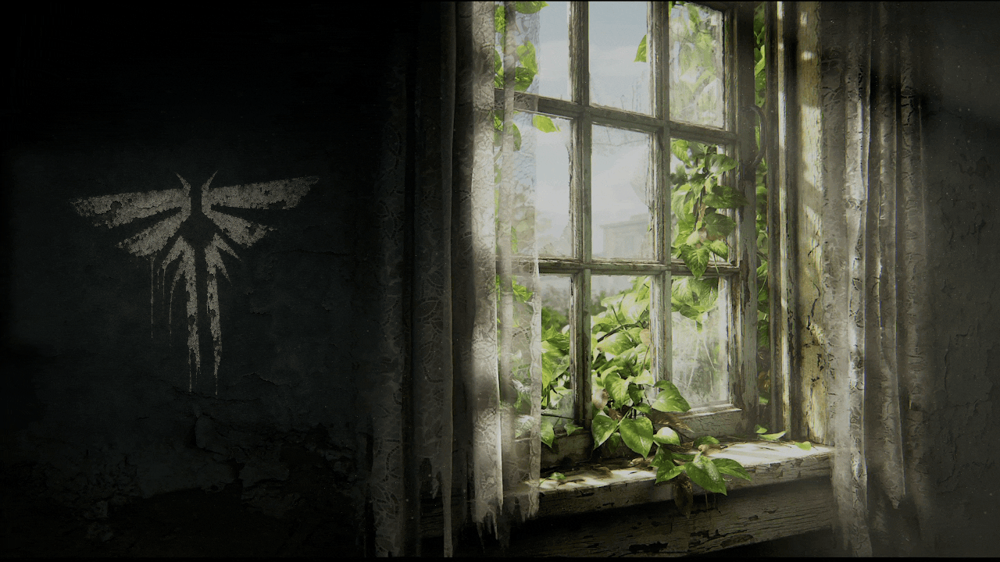
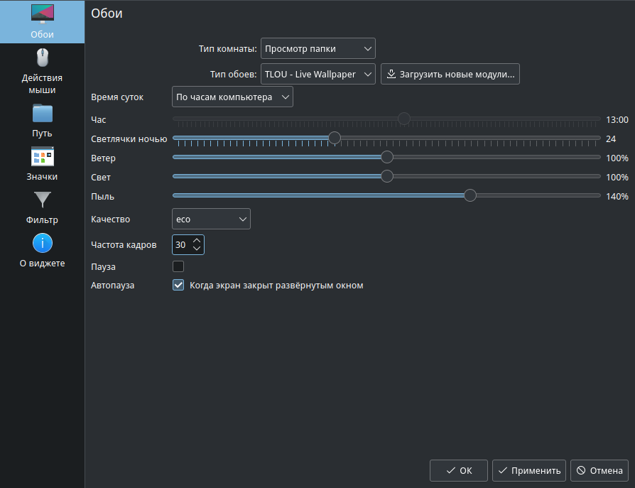

# TLOU - Live Wallpaper

Живые обои: свет из окна, движение штор и листвы, пыль в воздухе.
Один проект выпускает три файла: тему для Windows / Lively Wallpaper и нативные RPM для MOS 12 / KDE Plasma 5 и MOS 13 / KDE Plasma 6.



## Настройки в KDE Plasma



В настройках рабочего стола выбрать тип обоев **TLOU - Live Wallpaper**.
Доступны время суток (по часам компьютера или вручную), количество светлячков ночью, ветер, свет, количество пыли, качество, частота кадров, пауза и автопауза, когда экран закрыт развёрнутым окном. От времени суток зависит освещение: днём солнце, утром и вечером тёплые лучи, ночью лунный полумрак и светлячки за окном.
На скриншоте выбран режим eco с частотой 30 кадров/с. Такой режим снижает нагрузку на видеокарту.

## Установка

Готовые файлы публикуются в [Releases](https://github.com/xp9k/tlou-live-wallpaper/releases):

- `tlou-wallpaper-win-<версия>.zip` - тема для Lively Wallpaper. ZIP перетащить в окно Lively. Подробности: [Windows](docs/windows.md).
- `tlou-wallpaper-<версия>-1.mos12.noarch.rpm` - пакет для MOS 12 / KDE Plasma 5.27 / Qt 5.15. Установка: `sudo dnf install ./tlou-wallpaper-<версия>-1.mos12.noarch.rpm`. Подробности: [MOS 12](docs/mos12.md).
- `tlou-wallpaper-<версия>-1.mos13.noarch.rpm` - пакет обоев для MOS 13 / KDE Plasma 6. Установка: `sudo dnf install ./tlou-wallpaper-<версия>-1.mos13.noarch.rpm`, затем выбрать **Настройки рабочего стола > Тип обоев > TLOU - Live Wallpaper**. Подробности: [MOS 13](docs/mos13.md).

Для работы на MOS нужны только штатные Plasma и Qt Quick соответствующей версии. Браузер, Node.js, сервер и внешний проигрыватель не используются. На Windows тема работает через Lively; Node.js для неё не нужен.

## Структура

```text
src/          сцена, изображения и веб-рендерер (Windows / Lively)
plasma/       общая основа нативной интеграции с Qt Quick / Plasma
packaging/    RPM spec и метаданные Lively
docs/         инструкции и изображения
build/        сборка и проверка пакетов
```

Общие эффекты, шейдеры и подготовка изображения находятся в `src/scene.js`, изображения - в `src/assets`. Обе платформы собираются из одной сцены.

## Разработка и сборка

Для предпросмотра достаточно открыть `src/index.html` в браузере.

```sh
npm ci
npm run setup:browser   # Chromium для подготовки текстур и проверок
npm run preview         # обновить GIF: день, ночь и светлячки (нужны gifski и ffprobe)
npm run check
npm run build           # текстуры, шейдеры Qt, Windows ZIP, исходный архив RPM
npm test                # точный состав пакетов и отрисовка темы
npm run rpm             # только Linux с rpmbuild: RPM и тест установки
```

Для `npm run build` нужны Node.js 22+ и Qt 6 Shader Tools (`qsb`); путь можно задать переменной `QSB`.
`npm run rpm` собирает оба RPM и проверяет установку, повторную установку и удаление
во временном RPM root с отдельной базой. На Windows весь цикл выполняет
`build/build.ps1`: RPM собирается в контейнере podman внутри WSL
(параметры `-Distro`, `-Image`, `-Target mos12|mos13|all`; по умолчанию `all`).
Отдельная цель на Linux: `npm run rpm -- mos12` или `npm run rpm -- mos13`.
Сборка MOS 12 генерирует QML-оболочку Plasma 5 и исходные GLSL-шейдеры из той же сцены;
MOS 13 использует скомпилированные `.qsb`. Промежуточные файлы целей разделены.

На MOS 12 проверку реальной отрисовки можно выполнить в графическом сеансе:
`python3 build/verify-plasma5.py /usr/share/plasma/wallpapers/org.tlou.stillalive /tmp/tlou-check`.
Нужен установленный PyQt5 с Qt Quick и QtTest; проверка открывает тестовые окна,
включая развёрнутое окно для автопаузы. Для проверки статичного фона запустить
ту же команду с `QT_QUICK_BACKEND=software`.

Готовые файлы попадают в `dist/`, промежуточные - в `.cache/`. Обе папки не входят в Git.

Автор: [xp9k](https://github.com/xp9k). Фанатская работа по мотивам The Last of Us, не связана с Naughty Dog и Sony Interactive Entertainment.
