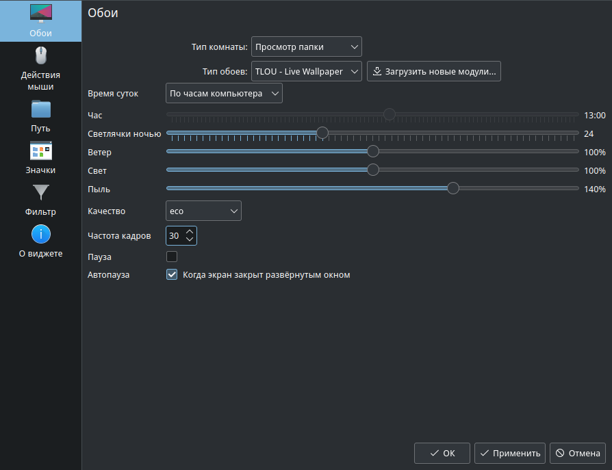

# TLOU - Live Wallpaper / MOS 13

Установить RPM через системный менеджер пакетов или из папки с файлом:

```sh
sudo dnf install ./tlou-wallpaper-1.0.0-1.mos13.noarch.rpm
```

Затем открыть **Настройки рабочего стола → Тип обоев → TLOU - Live Wallpaper**.
Пакет устанавливается для всех пользователей в
`/usr/share/plasma/wallpapers/org.tlou.stillalive`.
RPM не меняет текущий фон и не перезапускает Plasma.

Если ранее обои устанавливались через `install.sh`, пользовательская копия
может перекрывать системную. Для перехода на RPM удалить только прежнюю
пользовательскую установку, затем повторно выбрать тип обоев:

```sh
kpackagetool6 --type Plasma/Wallpaper \
  --packageroot "${XDG_DATA_HOME:-$HOME/.local/share}/plasma/wallpapers" \
  --remove org.tlou.stillalive
```

Обновление: установить новый RPM той же командой, затем повторно выбрать
обои или заново войти в сеанс. Удаление: `sudo dnf remove tlou-wallpaper`.

Требуется Plasma 6 / Qt Quick с аппаратным рендерингом. Анимация работает
внутри Plasma. Браузер, Node.js, сервер и отдельный проигрыватель не нужны.
При программном рендеринге Qt отображается статичное изображение.

В настройках доступны время суток, ветер, свет, пыль, качество, FPS
и пауза. Время суток по умолчанию следует часам компьютера: днём солнечный
свет, утром и вечером тёплые низкие лучи, ночью холодный лунный полумрак.
Можно выбрать режим «Вручную» и задать час. Ночью за окном светятся
светлячки, их количество задаётся в настройках (0 - отключить).
Автопауза включена по умолчанию: пока экран закрыт развёрнутым или
полноэкранным окном на текущем рабочем столе, анимация останавливается и не
нагружает процессор. Это особенно заметно при включённой трансляции экрана
(Veyon, VNC, RustDesk): каждый кадр анимации иначе приходится захватывать и
передавать.



На скриншоте показан выбор типа обоев и режим eco с частотой 30 кадров/с.
Для меньшей нагрузки выбрать eco и уменьшить частоту кадров.
